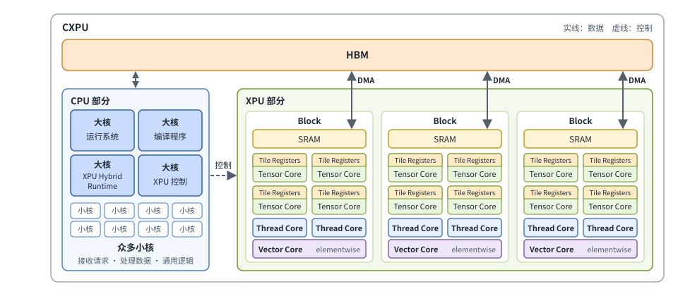
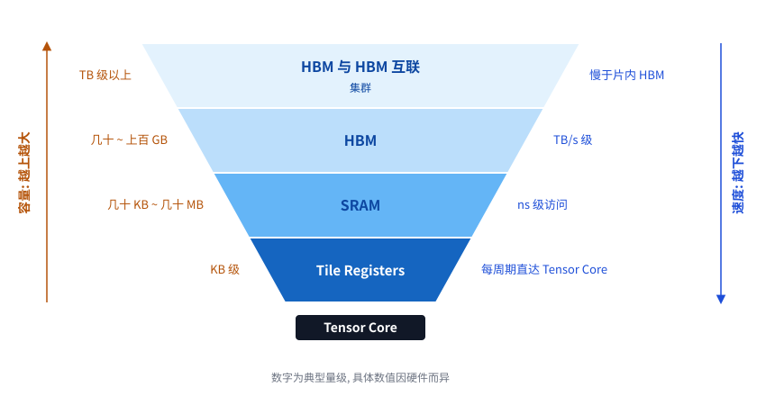
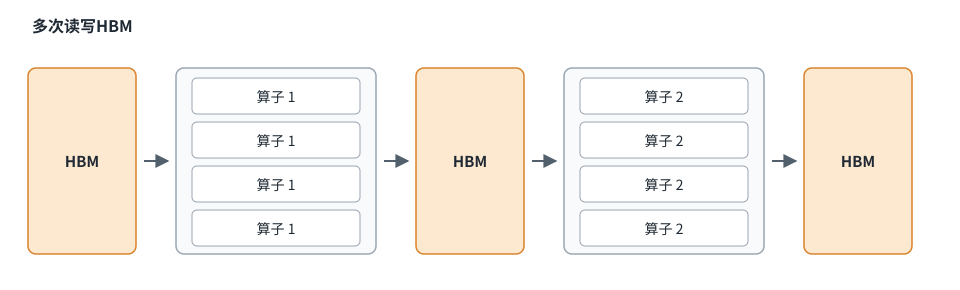
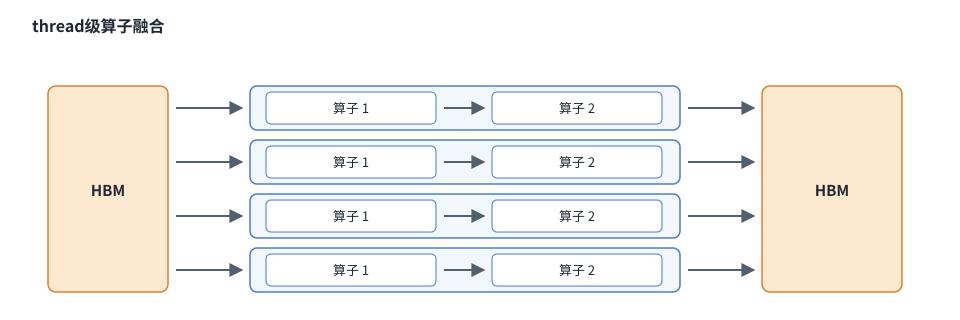
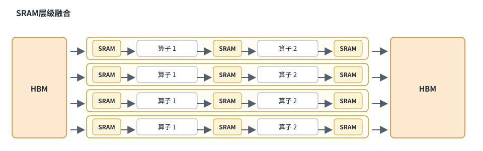
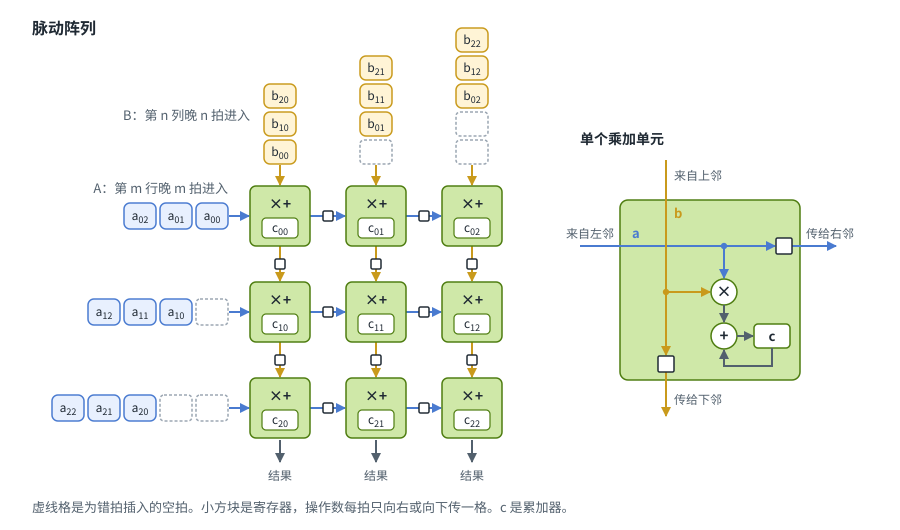
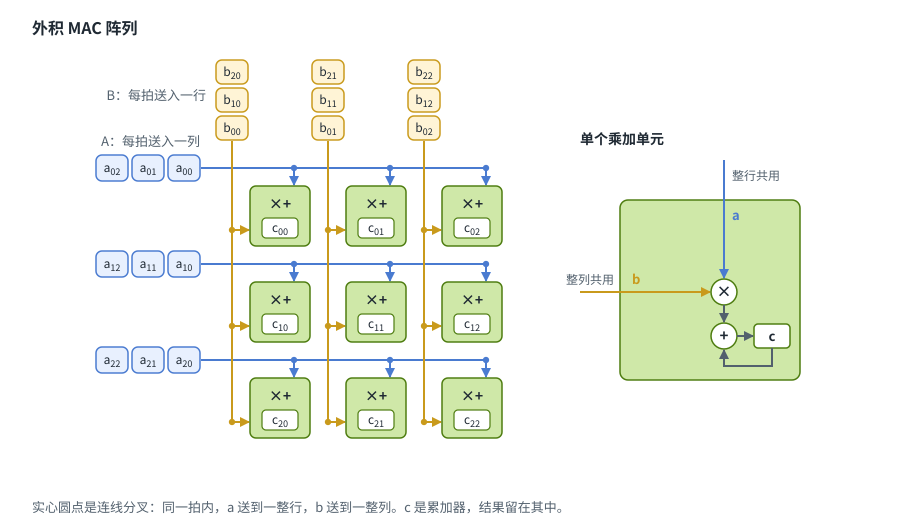
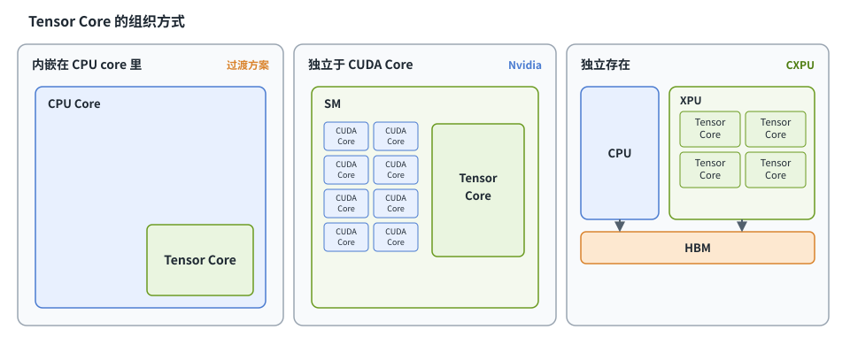
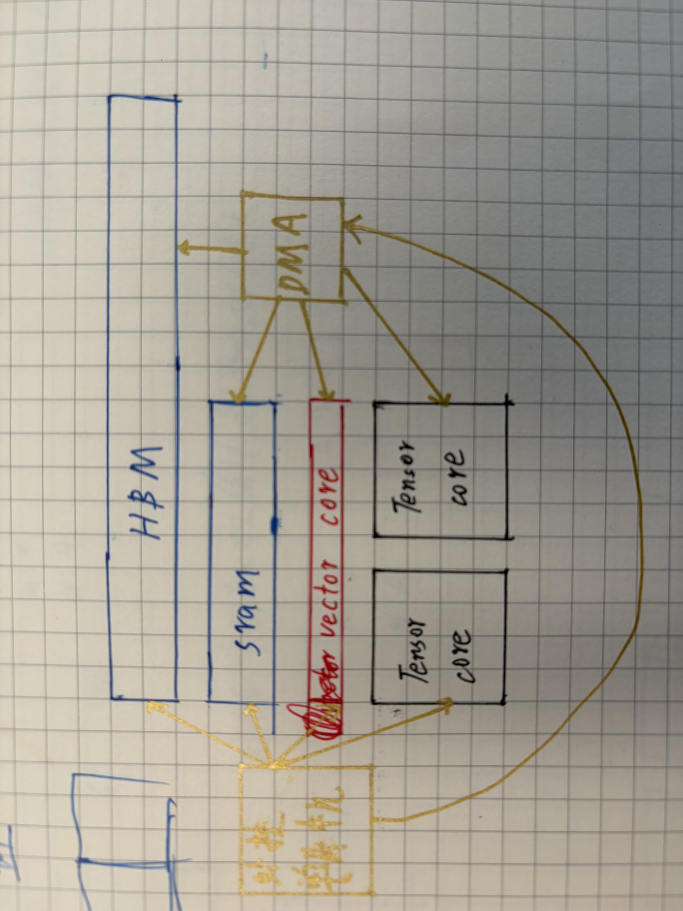
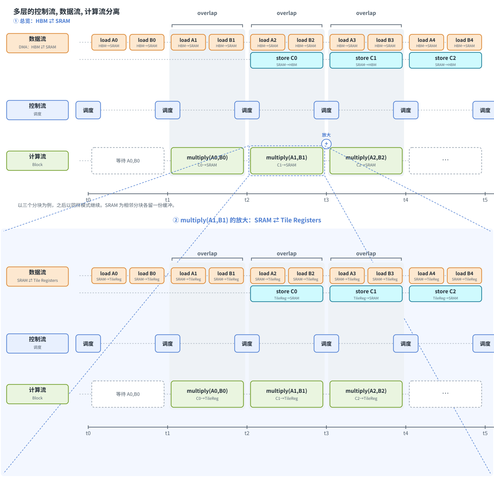

# CXPU芯片设计

## ——从软件角度以“多层存储”为核心设计LLM推理芯片



我们把要设计的这款芯片称为“CXPU”, 它由CPU部分和XPU部分组成. CXPU是针对LLM推理的“多batch”场景设计的. CXPU的设计借鉴了大量芯片的经验和思想这里不再赘述. 同时CXPU也有下面的特点:

- CPU和XPU都直连HBM, 共享外围存储, 这是异构计算思想的体现.
- XPU里引入了Thread Core(小型CPU), 再次体现了异构计算的思想.
- 明确可编程的多层存储架构, 必须和全新的编程范式配合使用
- 更多的是对现有IP的复用和组合, 而非重新设计

## 为什么要从软件角度审视芯片设计

作者是一名从事编译器工作的软件工程师, 从软件角度来审视芯片设计, 我们可以提前发现很多问题. 软件是硬件的用户, 这相当于用户在给芯片提需求.

我们可以从“存储带宽”, “存储大小”, “计算能力”, “功耗”, “存储价格”等多个维度对芯片准确建立数学模型. 有了准确的数学模型, 我们可以避免很多错误, 作出很多关键决策, 我只是搞一个设计概念图就不再展开了.

从软件角度, 我们是比较容易得到一些观点.

- 兼容CUDA并不是一个明智的选择
- 矩阵乘法为核心运算的芯片必须围绕”多层存储“来设计
- 把芯片设计制造当作玩乐高积木, 复用组合的不止是IP, 也是IP所对应的成熟软件生态
- 软件是非常重要的, 务必要招聘个懂“并行计算编译基本原理”的编译器工程师

## LLM推理芯片需求场景

LLM多batch推理最核心的计算是矩阵乘法. Attention里的QK和AV, MLP里的线性层, 本质上都是矩阵乘法. 计算量的绝大部分都在矩阵乘法上; softmax、norm、elementwise这些运算占比很小, 主要消耗的是带宽.

因此, CXPU是以矩阵乘法为核心需求设计的. 计算单元、存储层次和数据传输都应该围绕着矩阵乘法来设计.

## 多层存储架构

可以阅读“GEMM中的多层存储”一文[https://github.com/zhangzhimin/LLMDocs/blob/master/MultiLevelMemoryInGemm.md](https://github.com/zhangzhimin/LLMDocs/blob/master/MultiLevelMemoryInGemm.md). 这篇文章解释了为什么"多层存储"能够矩阵乘法中有效复用.

看下面这张图, 计算只是金字塔尖的一小部分, 它也许是最核心的, 但建造这座金字塔时, 计算并非最基础最大工作量的部分. 作为一名软件工程师, 在优化矩阵乘法的工作中, 我们会在多个层级读写数据, 只有在最后一层存储(register block)里, 才会将数据送入一个叫“gemm kernel”(不用自己写, 抄一个就好了)的单元里进行计算. 相对应的, CXPU一样也应该以”多层存储“为最核心的设计思想和工作重点. 至于Tensor Core, 建议买一个IP或者找个开源的.



这里在原有基础上, 增加了“集群的HBM与HBM互联”这个概念, 可以把集群里的HBM看作一个更大的存储, 网络间的通讯和内存的读写本质上一回事, 都是数据的传输. 关于集群这里我们有两个观点

- 集群及其互联是多层存储里的一层, 是芯片设计中的一部分, 也是最可能成为瓶颈的一部分.
- 集群相关的代码不要人工编写, 应该像其他层级存储的代码一样, 由编译器生成.

下面我们看一下CXPU的大致构成.

## CPU 部分

之所以把CPU也放进芯片里, 是因为让CPU和XPU都直连HBM, 把它们封装在一起共享存储, 这是将来比较合适的方式.

目前NVIDIA GPU + CPU的组合方式极大地增加了系统(尤其是内存)的开销, 也影响了整个系统的协同性. 以数据处理为例: 这部分工作由CPU完成, 结果还要再从DDR拷贝到GPU的HBM里, 这增加了IO开销, 并且数据处理本身同样也需要HBM的高带宽.

CXPU里包含一个较大规模的CPU, 这是异构计算思想的一次体现. CXPU的CPU部分和常见CPU一样, 由下面几部分组成:

### **数个大核**

大核承担运行系统、编译程序、控制XPU, 以及运行XPU的混合运行时等核心工作.

### **众多小核**

众多的小核负责接收请求、处理数据等通用逻辑, 它们也会承接GPU中cuda core负责的一部分工作.

整个CPU部分和我们现有的CPU是一样的, 可以购买IP或者使用开源的RISC-V. 更重要的是软件也会复用它们的成熟生态.

## XPU 部分

XPU由多个Block组成, 每个Block内部共享一块SRAM, SRAM可以和HBM直连, 通过DMA和HBM交换数据. 每个Block里包含众多Tensor Core, 以及必要的Thread Core和Vector Core.

### SRAM

SRAM是多层存储中的一个重要层级, 拥有很高的带宽. 我们需要为它设计合理的容量, 以满足以下两个性能目标:

- 不阻塞Tensor Core的计算
- 在Tensor Core计算的同时拷贝数据, 把从HBM取数据的时间overlap掉.

同时, 存储还需要具备非常好的可编程性和简单明确的运行机制. 需要在以下两方面加以改善:

- 明确的读写机制, 其带宽, 延迟等参数都是由明确指标的.
- 明确的可编程性, 我们可以对每个层级的存储进行精确控制.

有了这两点, 我们就可以借助编译器优化技术, 明确且合理地overlap多层存储之间的数据IO. 作为对比, CPU缺乏明确、可预期的方式来管理多层cache, 而GPU则可以通过shared memory来操作一部分cache.

### Vector Core

如果下层的Thread Core具备足够性能的超长向量化指令, 就不需要Vector Core了. 

Vector Core负责处理elementwise类的运算. 之所以把它放在Block这一层, 是因为我们需要在SRAM这个存储层级复用数据: 如果放在HBM这一层, HBM就会被重新读写一遍; 如果放进Tensor Core里, 则既不需要那么快, 也不需要那么多. 

这本质上就是我们常说的“算子融合”. 不同的是, CPU和GPU里的算子融合发生在线程层级, 相当于在寄存器里融合: 大部分不经过cache/shared memory, 只有一部分借助shared memory来完成.

### 算子融合

这里插入一节, 我们介绍一下算子融合, 这也解释了我们的Vector Core和Thread Core为什么会放在Block这一层共享SRAM. 算子不融合、thread级融合和SRAM层级融合, 本质上对应的是三种存储复用方式.



**算子不融合对应的是HBM复用: 多次读写HBM.** 每个算子单独执行: 算子1从HBM读入数据, 计算完后把中间结果写回HBM; 算子2再从HBM把中间结果读出来, 计算后写回HBM.

- 优点: 实现最简单, 每个算子可以单独实现、单独优化, 算子之间可以任意组合.
- 缺点: 中间结果要在HBM里多走一个来回. elementwise这类算子的计算量很小, 耗时几乎全花在读写HBM上, 每多一个算子就多一轮HBM读写, 此外还有额外的启动和同步开销.



**thread级融合对应的是寄存器复用.** 每个线程从HBM读入自己负责的数据, 在寄存器里连续完成算子1和算子2, 最后只把结果写回HBM一次. 这是目前CPU和GPU主要的融合方式.

- 优点: 中间结果留在寄存器里, 这是最快的一级存储; 无论融合多少个算子, HBM都只需要读写一次.
- 缺点: 只适合每个线程仅依赖自己数据的算子链, 比如连续的elementwise运算. 一旦算子需要其他线程的数据, 比如softmax、layernorm里的归约, 或者要处理Tensor Core输出的整块结果, 就得借助shared memory, 甚至无法融合. 寄存器容量也很有限, 融合的算子越多, 寄存器压力越大. 另外, 每一种算子组合都要生成一份专门的融合代码, 组合越多, 编译器越复杂.



**SRAM层级融合对应的是SRAM复用.** 数据按块(tile)从HBM搬到SRAM, 算子1从SRAM读、往SRAM写, 算子2接着从SRAM读、往SRAM写, 只有最终结果才写回HBM.

- 优点: 中间结果都留在片上, HBM同样只需要读写一次. SRAM在Block内共享, 容量比寄存器大得多, 中间结果可以被Tensor Core、Vector Core、Thread Core等不同单元直接使用, 也不受线程之间数据依赖的限制, 归约、转置这类运算同样可以融合. 每个算子仍然可以作为独立的程序运行在SRAM上, 组合起来很灵活, 不需要为每一种组合生成专门的融合代码. 再配合DMA, 还能把HBM的读写和计算overlap起来.
- 缺点: SRAM的带宽和延迟都不如寄存器, 每个算子都要多读写一次SRAM, 会占用SRAM带宽并带来额外功耗. SRAM容量也有限, tile的大小和调度需要仔细规划, 这就要求SRAM是一块可以明确管理、可编程的存储.

三种方式里, SRAM层级融合是我们的首选, 因为它在灵活性和性能之间取得了很好的平衡.

- 避免了HBM的多次读写, 提高了性能
- 避免了寄存器的限制, 可以有效处理归约运算

### Thread Core

这里我们的Thread Core是一个通用的小型CPU, 可以处理一些不常见的、包含控制流的运算. 因此Thread Core是可以有多个的. 这里不妨和NVIDIA GPU做个对比: 我们把NVIDIA GPU里的CUDA Core削减到非常小的规模. 这其实是可行的, 因为CUDA Core在GEMM里扮演的几个角色都可以被替代:

- 处理剩余数据. 比如129x129的数据, 先用Tensor Core处理128x128, 剩下的部分再交给CUDA Core. 这不是必需的, 提前padding就可以了.
- Pack数据. 先把matrix weights pack好, 再放到Tensor Core里处理. 这也不是必需的, weights可以提前在CPU里pack好, 不需要每次都pack.
- 拷贝数据. 把HBM里的数据拷贝到shared memory里. 这同样不是必需的, 直接通过DMA把数据从HBM搬到SRAM即可, 新版的NVIDIA GPU也是这么做的(TMA).
- 调用Tensor Core. 这种做法本身就不对, 应该由芯片外的CPU来控制Tensor Core.
- Pack多batch的activations. 这一步无法提前完成, 但activations的规模比weights小得多, 用极少量的Thread Core就足够了.

所以, 我们本质上是在NVIDIA GPU的基础上做了一次减法, 把大量的CUDA Core去掉了.

### Tensor Core

接下来是最核心的计算单元: Tensor Core. 它包含Tile Registers, 这体现了多层存储的思想. 
我们这里的Tensor Core指的是用于矩阵乘法的计算单元, 按惯例也叫这个名字.
Tensor Core的实现常见的有外积MAC阵列和脉动阵列两种.



- 优点: 每个乘加单元只和相邻的单元相连, 连线短而规整, 没有长距离的广播, 阵列做大以后也容易保持较高的主频. 连续计算多块数据时, 填充的延迟还可以被摊薄.
- 缺点: 数据要逐格传递, 输入必须按行列错拍送入. 一块N×N、内积长度也是N的数据, 从第一个数进入到最后一个结果出来一共要3N-2拍, 其中2N-2拍都花在填充和排空上. 此外, 每个乘加单元还要多一组用来传递数据的寄存器.

和脉动阵列相关, 还存在一门非常古老却极其重要的编译优化技术, 这门技术我们后续有机会再介绍, 这里不再涉及.



反观MAC阵列, 它的设计很简单, 就是把多个向量单元展开并连接起来, 使用起来也很简单.

- 优点: 没有逐格错拍, 时延只等于内积长度K, 不随阵列边长增加. 操作数不在乘加单元之间传递, 每个单元只累加自己的结果, 省掉了传递数据的寄存器.
- 缺点: A和B要在同一拍内广播给一整行和一整列, 连线长、扇出大, 阵列越大越难在一拍内完成, 因此单个阵列的规模会受到限制.

目前Google TPU使用的是脉动阵列. ARM的SME, Intel和Apple的AMX都采用了MAC阵列.

既然提到了AMX, 下面就介绍一下Tensor Core的组织方式.

### Tensor Core的组织方式



把Tensor Core内嵌在CPU Core里只是一种过渡方案, 随着规模增大, 它必然会独立出来组织. 实际上, Intel的AMX仍然内嵌在每个CPU Core里, 而Apple的AMX已经独立于CPU Core之外, 由一组CPU Core共享; NVIDIA GPU的Tensor Core同样独立于CUDA Core.
但在软件层面, 上述芯片的Tensor Core几乎都还是按照上图最左边那种“嵌入线程(CPU)”的方式来使用的, 就是在一个thread里调用Tensor Core, 获取计算结果后, 再由这个thread继续执行后续的计算.

## CUDA是护城河还是枷锁?

CUDA是在核函数里调用Tensor Core的, 下面是一个代码片段:

```c++
#include <mma.h>
#include <cuda_fp16.h>
using namespace nvcuda;

__global__ void mma_16x16(const __half* A, const __half* B, float* C) {
    wmma::fragment<wmma::matrix_a, 16, 16, 16, __half, wmma::row_major> a;
    wmma::fragment<wmma::matrix_b, 16, 16, 16, __half, wmma::row_major> b;
    wmma::fragment<wmma::accumulator, 16, 16, 16, float> c;

    wmma::fill_fragment(c, 0.f);
    wmma::load_matrix_sync(a, A, 16);   // 32 个线程一起装 A
    wmma::load_matrix_sync(b, B, 16);
    wmma::mma_sync(c, a, b, c);         // 整个 warp 协同完成一次矩阵乘
    wmma::store_matrix_sync(C, c, 16, wmma::mem_row_major);
}
// mma_16x16<<<1, 32>>>(A, B, C);

```

这种方式存在几个明显的问题:

- 在SIMT这种形式下, thread idx失去了对应关系, 无法和Tensor Core有效对应.
- 一个warp里的多个线程共同启动同一个Tensor Core, 和SIMT的语义不符.
- CUDA Core和Tensor Core会相互阻塞.
- 无法很好地overlap数据加载.

究其根本, “SIMT”这种基于thread(idx)的编程方式, 已经和拥有Tensor Core的NVIDIA GPU架构不再匹配. CUDA到底是NVIDIA的护城河, 还是枷锁? 时间会给我们答案.

## 分层分离设计

### ——外挂单片机



早先我把这种想法称为“外挂单片机”, 因为在我看来, 以矩阵乘法为核心运算的芯片, 就是把多层存储搭一下, 最下层放一个Tensor Core, 然后外挂一个微控制器来控制“数据传输”, “调度计算”就可以了. CXPU是这种方式的完善和进一步细化.

在我们的程序里一直存在着“控制流, 数据流, 计算流”三种东西.

- 控制流就是我们常见的if, for, while等控制语句和一些指令.
- 数据流就是数据的传输和存储.
- 计算流就是计算的执行和调度.

我们现在的编程语言基本都是从C语言派生的, 其代码和编译优化本质上是围绕控制流展开的. 而在现在的LLM的计算场景里, 控制流占比很小, 数据的传输和计算才是重点. 所以类C语言的编程方式已经无法很好地适配LLM的计算场景.
分离设计的思想让我们把“控制流, 数据流, 计算流分开, 放到同等重要的位置”. 这在软硬件的设计上都是要有体现.



从上面的时序图我们可以看出, 通过“控制流”对“数据流”和计算的多层分离调度, 是可以有效overlap存储和计算之间的等待的.
目前的芯片不能达到一个比较理想的带宽和计算峰值, 就是因为数据和计算之间的关系并不明确. 我们可以通过:

- 明确可编程的多层存储
- 符合场景的存储大小, 带宽和计算之间的平衡
- 控制流, 数据流和计算流分层分离的全新编程方式

来明显改善芯片的带宽和计算峰值.

## 关于KV Cache

我们没有过多地关注KV Cache的需求, 因为在CXPU的架构里有着共同的HBM, 很容易通过CPU来调度KV Cache; 我们只需要增加KV Cache所需的存储空间就可以很好的适配KV Cache带来的需求. 

## 现有芯片和CXPU的对比

CXPU是我想象中LLM推理芯片的样子, 我并没真实地去实现, 所以不说CXPU的优点, 更多地会指出其他芯片的不足.

对于NVIDIA GPU来说:

- 不该困于CUDA生态, 应该研发全新的编程范式
- 积极整合ARM CPU和GPU
- CUDA Core还是删一删, 多得不像样子

对于AMD来说:

- 开始整合CPU和GPU是非常好的进步
- 切勿花过多精力兼容CUDA, 直接研发合适的编程范式

对于Groq来说:

- 要不SRAM跟Cerebras一样大, 要不就加个HBM

Google TPU目前来说是最合理的, 对于Google TPU来说:

- 如果脉动阵列是为了算卷积, 可以改MAC阵列
- TPU里面还是得配CPU(Thread Core), 缺的不是用于控制的CPU, 而是参与计算的CPU. 缺乏异构计算的思想.
- 没有公开的编程接口和工具链.

对于Tenstorrent Blackhole来说:

- 片上放能跑系统的大核, 计算单元里只留负责调度的小核, 这个方向是对的
- 每个计算单元的SRAM只有1.5 MB, 做不到SRAM这一层的融合, 其并不是围绕内存设计的芯片
- CXPU借鉴了Tenstorrent这种把现有IP复用和组合的思想

## 给芯片创业公司的建议

CXPU并没有什么创新的地方, 它合理地借鉴了现有芯片的优缺点, 然后复用和组合了现有的IP. 我觉得现在的芯片创业公司不应该把关注点过多地放在“指令怎么设计”, “如何创造新的架构”, “功耗怎么样”, “如何兼容不同场景”, “适配各种算子”, 甚至“如何制造流片”这些问题上来.作者觉得创业公司造芯片这样更为合理:

- 只专注LLM多batch推理场景
- 围绕“矩阵乘法”, 通过数学建模分析把计算和存储之间的平衡找出来, 然后再根据KV Cache的需求来进一步调整.
- 将IP复用和组合起来, 尽可能地减少做底层设计的工作.
- 找到博通这类公司进一步完善设计和外围电路.
- 找到台积电这类公司制造生产.
- 与此同时, 尽快联系作者来实现相应的编译器, 从软件层面协同芯片的设计.

## 后文

*本文由作者主笔; AI协作, 生成插图和审核*

*作者寻求工作和合作等机会, 有合适的可以微信联系“zhangzhimin-jtu”, 邮箱“p3.1415@qq.com”*

*本文欢迎转载, 请注明出处*

---

*张志敏*

*2026年11月13日于昆明*
