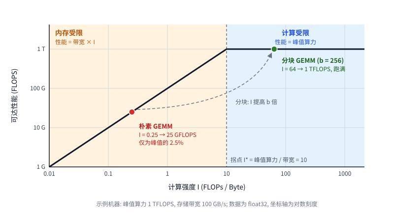
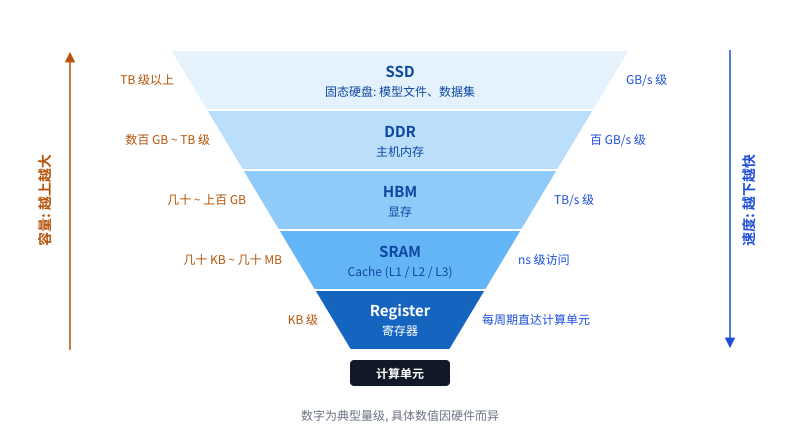

# GEMM中的多层存储

GEMM (General Matrix Multiply) 即 $C \leftarrow C + AB$。下文默认 $A$、$B$、$C$ 都是 $n \times n$ 的 float32 矩阵 (每个元素 4 Byte)，一次 GEMM 共 $2n^3$ 次浮点运算 (FLOPs)。

## 1. 计算强度

计算强度 (Arithmetic Intensity) 指每搬运 1 Byte 数据所完成的浮点运算次数：

$$
I = \frac{\text{运算量 (FLOPs)}}{\text{搬运量 (Bytes)}}
$$

这里的搬运量是计算单元与存储之间来回传输的数据量。一台机器有两个上限：峰值算力 $P$ (FLOPS) 和存储带宽 $W$ (Byte/s)。程序能达到的性能是两者中较紧的那个，这就是 Roofline 模型：

$$
\text{性能} = \min(P,\ W \cdot I)
$$



- $I < P/W$：**内存受限**，算力再强也只是在等数据。
- $I \ge P/W$：**计算受限**，算力才能跑满。

计算强度是算法及其实现的属性，不是硬件的属性。同样是 GEMM，写法不同，计算强度可以差出几个数量级。后面几节讲的都是如何把它提上去。

## 2. 大尺寸 GEMM 的内存墙

GEMM 本应是计算强度很高的运算：数据只有 $3n^2$ 个元素，运算却有 $2n^3$ 次，理想强度正比于 $n$。但这要求每个元素只搬运一次，也就是三个矩阵能同时放进离计算单元最近的快速存储 (cache)。

矩阵一大就放不下了。看朴素的三重循环：

```c
for (i = 0; i < n; i++)
    for (j = 0; j < n; j++)
        for (k = 0; k < n; k++)
            C[i][j] += A[i][k] * B[k][j];
```

每算一个 $C_{ij}$ 都要扫过 $A$ 的一整行和 $B$ 的一整列。当矩阵远大于 cache 时，这些数据在下次用到之前早已被换出，于是每次乘加的操作数都要重新从内存读取：

```mermind

- 运算量：$2n^3$ FLOPs
- 搬运量：约 $2n^3$ 个元素，即 $8n^3$ Byte
- 计算强度：约 $0.25$ FLOPs/Byte，与 $n$ 无关

```

(实际运行时 $A$ 的当前行可能留在 cache 里，但 $B$ 的每一列都要重读，量级不变。)

以上图的示例机器 (1 TFLOPS，100 GB/s) 为例，跑满算力需要 $I \ge 10$，而朴素 GEMM 只有 0.25，性能被带宽锁死在 25 GFLOPS，只有峰值的 2.5%。算力闲着等数据，这就是内存墙。

## 3. 分块为什么能解决内存墙

把矩阵切成 $b \times b$ 的小块，让三个块 ($3b^2$ 个元素) 能同时放进快速存储，然后以块为单位做乘法：

$$
C_{IJ} \leftarrow C_{IJ} + A_{IK} B_{KJ}
$$

一次块乘搬入 $A_{IK}$和 $B_{KJ}$ 共 $2b^2$ 个元素 ($C_{IJ}$ 在 $K$ 循环期间常驻)，却完成 $2b^3$ 次运算。**每个搬进来的元素被复用 $b$ 次，而不是 1 次。**

总共 $(n/b)^3$ 次块乘，搬运量为 $(n/b)^3 \cdot 2b^2 = 2n^3/b$ (另有 $C$ 的读写 $2n^2$，可忽略)。与朴素算法对比：

- 朴素：搬运约 $2n^3$ 个元素，计算强度 $0.25$ FLOPs/Byte
- 分块：搬运约 $2n^3/b$ 个元素，计算强度 $0.25b$ FLOPs/Byte
- 内存读写减少的倍数就是块的边长 $b$

块能取多大由快速存储的容量决定：

- $b = 32$ (三个块共 12 KB，放得进 L1)：内存读写减少 **32 倍**
- $b = 256$ (三个块共 768 KB，放得进 L2)：内存读写减少 **256 倍**
- $b = 1024$ (三个块共 12 MB，放得进 L3)：内存读写减少 **1024 倍**

一般地，快速存储能放 $M$ 个元素时 $b \approx \sqrt{M/3}$，读写减少的倍数正比于 $\sqrt{M}$。这也是理论上的最优：Hong 和 Kung (1981) 证明了常规矩阵乘法的搬运量下界为 $\Omega(n^3/\sqrt{M})$。

回到示例机器：$b = 32$ 时计算强度为 8，性能 800 GFLOPS；$b \ge 40$ 即越过拐点，算力跑满。

## 4. 多层存储，多次分块

真实机器的存储不是一快一慢两层，而是由多层存储构成的：越靠近计算单元越快、越小，越远越慢、越大。只分一次块，只能照顾到其中一层边界：



- 块按最内层取小：内层边界的搬运少了，但外层边界上的搬运量仍是 $2n^3/b_{小}$，对低带宽的外层来说还是太多。
- 块按外层取大：块放不进内层，块内的计算又退化成朴素算法。

解决办法是递归分块：大块按外层容量取，大块内部再按内一层的容量切成小块，一直切到最内层。这样每一层边界都各自满足第 3 节的结论。设第 $i$ 层容量为 $M_i$、带宽为 $W_i$，对应的块边长 $b_i \approx \sqrt{M_i/3}$，则：

- 第 $i$ 层边界上的搬运量约为 $2n^3/b_i$，计算强度 $I_i \propto b_i \propto \sqrt{M_i}$
- 整体性能 $= \min\left(P,\ \min_i W_i I_i\right)$

也就是说，每一层都要满足 $W_i \sqrt{M_i} \gtrsim P$ 才不拖后腿。越外层带宽 $W_i$ 越低，但容量 $M_i$ 越大，块就越大，需要的搬运量就越少：**容量正好补偿了带宽**。这就是多层存储配合多次分块高效的原因。

从 GEMM 的角度看，下面这些都是同一个抽象——"一个容量为 $M_i$、带宽为 $W_i$ 的存储"，区别只在数字：

| 层级 | 典型容量 | 速度 | GEMM 中这一层装的"块" |
| ---------- | ------------------------------------- | --------------------------------- | ------------------------ |
| 寄存器 | KB 级 (AVX-512：32 × 64 B；AMX：8 × 1 KB) | 每周期直达运算单元 | micro-kernel 中常驻的 $C$ 小块 |
| L1 cache | 几十 KB | 约 1 ns | 几十 × 几十的块 |
| L2 cache | MB 级 | 几 ns | 几百 × 几百的块 |
| HBM (显存) | 几十至上百 GB | 带宽 TB/s 级 | 整个算子的矩阵，乃至·整个模型 |
| DDR (主机内存) | 数百 GB 至 TB 级 | 带宽百 GB/s 级，经 PCIe 到 GPU 只有几十 GB/s | HBM 放不下的部分，按块换入 |
| SSD (固态硬盘) | TB 级以上 | 带宽 GB/s 级 | DDR 放不下的部分，按块读入 |

寄存器是最里层的 "cache"，SSD 是最外层的"内存"。micro-kernel 把 $C$ 的小块留在寄存器里、cache blocking、显存放不下时从主机内存分块换入、主机内存放不下时从 SSD 分块读入，都是同一个分块思想在不同层级上的重复。

(表中数字为典型量级，具体数值因硬件而异。)

## 5. 为什么 LLM 需要最外层足够大、最内层足够快

LLM 的训练和推理几乎全是 GEMM：权重矩阵 (共 $N$ 个参数) 乘以激活 (一批 $T$ 个 token)。每处理一批 token 都要把全部权重用一遍，运算量约 $2NT$ FLOPs。把前面的结论套上去：

**最外层要足够大。** 分块消除的是重复搬运，消不掉"每个数据至少搬一次"。权重每一遍都要用，所以装下整个问题 (权重、KV cache、激活) 的那一层必须足够大；一旦装不下，溢出的部分每一遍都得从更外一层重新搬，而更外一层的带宽通常低一到两个数量级。例如 70B 参数的模型以 fp16 存储要 140 GB：放得进 HBM，权重走的是 TB/s 级的通道；放不进，就得走几十 GB/s 的 PCIe，慢几十倍。最外层的容量决定了能跑多大的模型。

**最内层要足够快。** 各层边界上的搬运量约为 $2n^3/b_i$，越往里块越小、流量越大，全部 $2NT$ 次运算的操作数最终都要流经最内层。外层再大再快，最内层的吞吐才是 Roofline 的"屋顶"。而 LLM 的运算量极大：每个 token 约 $2N$ FLOPs，70B 参数的模型就是每 token $1.4 \times 10^{11}$ FLOPs。最内层的速度决定了跑得多快。

两者合起来就是一座理想的金字塔：容量由内向外递增，带宽由外向内递增。LLM 的参数量把外层容量的需求推到极致，运算量把内层速度的需求推到极致。

另外，LLM 里权重的复用次数受 $T$ 限制：每搬一次权重最多用 $T$ 次。逐 token 解码时 $T$ 很小，计算强度很低，此时存放权重的那一层的带宽直接决定速度——每秒最多把权重过 (带宽 ÷ 模型字节数) 遍，140 GB 的模型配 3 TB/s 的 HBM 约为每秒 20 遍。这也是 LLM 既要 HBM 大、又要 HBM 快的原因。
